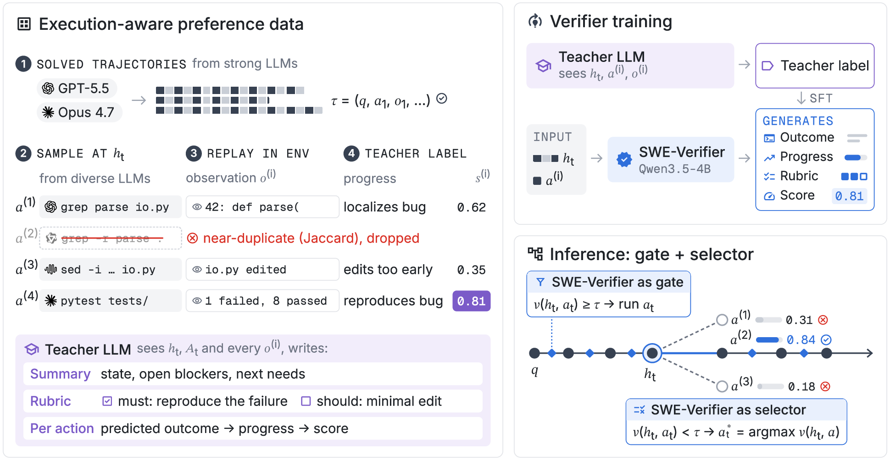

# SWE-Verifier: Selective Verification for Cost-Efficient Coding Agents

[](https://arxiv.org/abs/2610.30284)
[](https://huggingface.co/collections/zkjzou/swe-verifier)

SWE-Verifier is a lightweight verifier for coding agents built on Qwen3.5-4B. It scores a proposed action, triggers additional sampling when the score is below a threshold, and selects the best candidate before execution. This repository provides the Mini-swe-agent integration, inference recipes, prompts, data-construction pipeline, and training scripts.

## Overview



*Method overview from Figure 2 of the paper.*

Preference data is built by sampling candidate actions from successful trajectories, replaying them to collect observations, and obtaining rubric-guided teacher labels. At inference, the verifier uses only the task, observed history, and proposed action. The gate determines whether to sample alternatives; the selector chooses the action to execute.

| Variant | Action assessment |
| --- | --- |
| Untrained | Base Qwen3.5-4B scoring |
| Score Only | Trained action scoring |
| Joint Rubric | Rubric and score generated together |
| Two-Stage Rubric | Candidate-specific rubric generation followed by scoring |

Recipes also cover no verification, trajectory-level selection, all-step verification, and gate-only use with policy-model selection.

## Quickstart

### 1. Install

Use Python 3.11+ and Docker for benchmark tasks.

```bash
git clone https://github.com/zkjzou/SWE-Verifier.git
cd SWE-Verifier
python -m venv .venv
source .venv/bin/activate
pip install -c constraints.txt -e '.[native]'
```

Try the small offline example without model credentials or a GPU:

```bash
mkdir -p runs
python examples/offline_demo.py --output runs/offline-demo.json
```

### 2. Serve the verifier

In a separate GPU environment, install a [vLLM version supporting Qwen3.5](https://docs.vllm.ai/en/latest/models/supported_models.html) and serve the Two-Stage Rubric checkpoint. Authenticate with Hugging Face if access is required.

```bash
vllm serve zkjzou/SWE-Verifier-Two-Stage-Rubric \
  --served-model-name zkjzou/SWE-Verifier-Two-Stage-Rubric \
  --max-model-len 262144 \
  --port 8000
```

The client uses the native `/v1/completions` endpoint. Checkpoint revisions and serving requirements are documented in the [model card](docs/model-card.md).

### 3. Run SWE-Verifier

Configure credentials for your policy provider, then replace `<provider/model>` with its LiteLLM model identifier:

```bash
swe-verifier run \
  --recipe selective_two_stage \
  --policy-model '<provider/model>' \
  --gate-url http://localhost:8000/v1 \
  --instance-id django__django-13279 \
  --output runs/two-stage/django__django-13279
```

Add `--policy-url` for a custom policy endpoint. The verifier acts as both gate and selector. Defaults are **three verifier draws per action**, **three candidates when triggered**, and **250 agent steps**. Inspect all settings with:

```bash
swe-verifier run --recipe selective_two_stage --dry-run
swe-verifier run --list-recipes
```

For gate-only use, choose `--recipe gate_only` and serve the [Score Only checkpoint](https://huggingface.co/zkjzou/SWE-Verifier-Score-Only) at `--gate-url`; the policy model selects among candidates. Inspect the [recipe configurations](src/swe_verifier/recipes) for thresholds, model settings, and budgets.

## Training

The [`training/`](training/README.md) folder provides recipes for Score Only, Joint Rubric, and Two-Stage Rubric on one node with **4 × H200 GPUs**. After installing the separate training environment:

```bash
python -m training.prepare --output training/data
bash training/launch.sh --recipe joint_rubric \
  --data training/data --output training/outputs/joint_rubric
```

See the [training guide](training/README.md) for setup, all three variants, smoke runs, and checkpoint resume.

## Data and evaluation

Find checkpoints and datasets in the [Hugging Face collection](https://huggingface.co/collections/zkjzou/swe-verifier). The [data guide](docs/data.md) covers candidate sampling, replay, teacher annotation, and dataset export. The [training scripts](training/README.md) use the pinned historical exports.

Runs export `predictions.jsonl`. Grade these patches with a separately configured [SWE-bench harness](https://github.com/SWE-bench/SWE-bench), then import its report:

```bash
swe-verifier evaluate --runs runs/two-stage --report official-report.json
```

## Citation and license

If you use SWE-Verifier, please cite:

```bibtex
@misc{zou2026sweverifier,
  title         = {{SWE-Verifier}: Selective Verification for Cost-Efficient Coding Agents},
  author        = {Kaijian Zou and Vaibhav Chennareddy and Yunxiang Zhang and Naihao Deng and Longju Bai and Jiaxin Pei and Rada Mihalcea and Lu Wang},
  year          = {2026},
  eprint        = {2610.30284},
  archivePrefix = {arXiv},
  primaryClass  = {cs.LG},
  url           = {https://arxiv.org/abs/2610.30284}
}
```
